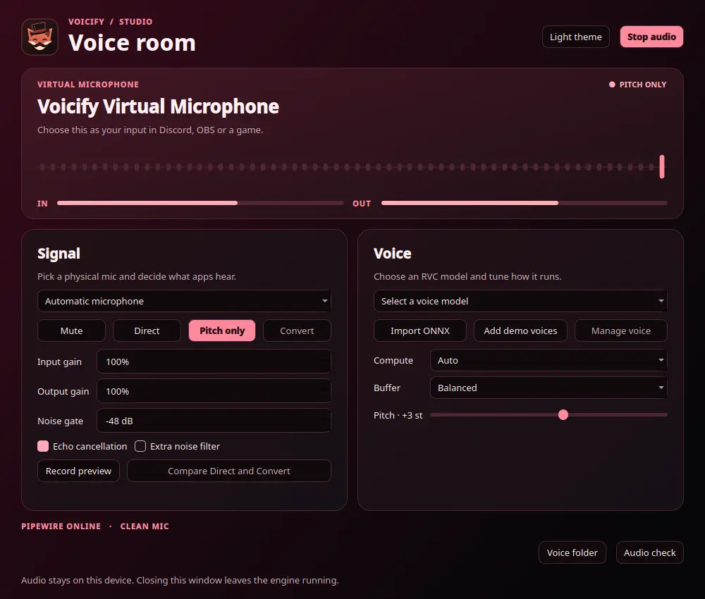

<p align="center"></p>

<h1 align="center">Voicify</h1>

<p align="center">A voice studio for Linux. One virtual mic for calls, recording, and games.</p>

<p align="center">
  <a href="https://github.com/aronyok-io/Voicify/releases/latest"><strong>↓ Download for Fedora</strong></a>
  · <a href="#voice-models">Voice models</a>
  · <a href="docs/engineering.md">How it works</a>
</p>

<p align="center"></p>

## Get on the mic

1. Download the Fedora 44 x86-64 RPM from [Releases](https://github.com/aronyok-io/Voicify/releases/latest).
2. Install it from the download directory.

   ```bash
   sudo dnf install ./voicify-1.1.0-1.fc44.x86_64.rpm
   ```

3. Open **Voicify** from your app menu and choose **CPU** or **NVIDIA CUDA**. First launch downloads the runtime into your user account.
4. Click **Start audio**, choose **Direct** to check your mic, and select **Voicify Virtual Microphone** in Discord, OBS, or your game.

Use **Record preview** with headphones to hear what the virtual mic sends. Studio records four seconds, plays the clip once, and discards it.

## In Studio

| Control | What it does |
| --- | --- |
| **Direct** | Pass your mic through with optional echo cancellation and noise filtering. |
| **Pitch only** | Raise or lower the pitch of your mic without loading an RVC voice. |
| **Convert** | Change your voice locally with an RVC ONNX model on CPU or NVIDIA CUDA. |
| **Mute** | Stop mic capture while keeping the virtual mic available to other apps. |
| **Stop audio** | End the audio engine and remove the virtual mic. Closing the Studio window leaves the engine running. |

## Voice models

Use **Import ONNX** to add a compatible RVC voice and ContentVec or HuBERT encoder. Set the sample rate and speaker ID to match the model. The Fedora download includes the app and installs its runtime on first launch. Bring your own ONNX graphs, or put the optional demo files in `${XDG_DATA_HOME:-$HOME/.local/share}/voicify/demo-assets` and choose **Add demo voices**. See the [model guide](docs/models.md) for supported formats and checksums.

<details>
<summary>Runtime and uninstall</summary>

Stop audio before switching engines with `voicify setup cpu` or `voicify setup cuda`. The CUDA runtime uses CUDA 12 and cuDNN 9 wheels and needs a working NVIDIA driver. Auto falls back to CPU if CUDA cannot initialize.

Stop audio before running `sudo dnf remove voicify`. Your settings, imported graphs, and runtime stay in your user account. Voicify uses standard XDG paths. The engine log is in `${XDG_STATE_HOME:-$HOME/.local/state}/voicify/engine.log`.

</details>

<details>
<summary>Run from source, test, or build the RPM</summary>

Install Fedora’s `python3-pyside6`, `pipewire-utils`, `pipewire-pulseaudio`, `pulseaudio-utils`, `wireplumber`, and `uv` packages.

```bash
./setup cpu
./launch
```

Use `./setup cuda` for NVIDIA. To check or stop the engine from a terminal, run `./launch status`, `./launch mode mute`, or `./launch stop`.

```bash
.venv/bin/python -m unittest discover -s tests -v
```

For the live PipeWire test, stop Voicify first and set `VOICIFY_TEST_PIPEWIRE=1`. To test conversion too, run `./launch demo-voice` and set `VOICIFY_TEST_MODEL` to the ID it prints. The test uses a synthetic input.

To build the RPM, install `rpm-build`, `desktop-file-utils`, and `appstream`, then run this from a committed checkout.

```bash
bash packaging/build-rpm /tmp/voicify-rpm
```

</details>

[MIT license](LICENSE) · [Third-party notices](THIRD_PARTY_NOTICES.md)
